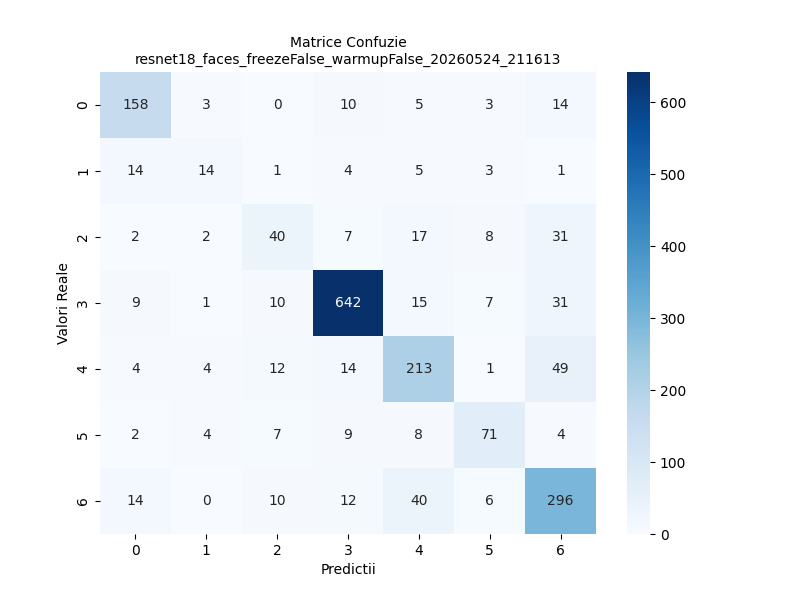
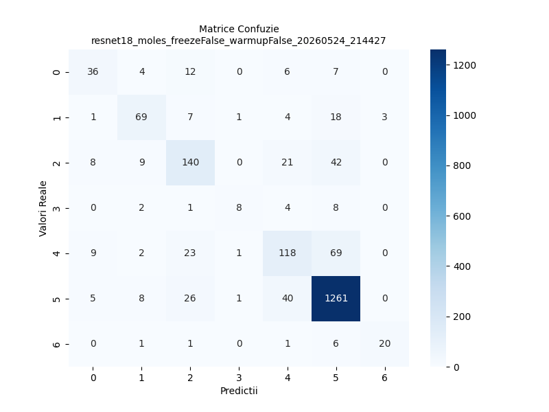

# Image Classification with Neural Networks

A PyTorch pipeline that trains and compares MLP, CNN and fine-tuned ResNet18 models on two imbalanced 7-class image datasets: facial expressions and skin lesions. Built as a university Artificial Intelligence assignment.

It includes experiments on dropout, batch normalization, data augmentation, class balancing and transfer learning, with TensorBoard logging and Kaggle submission generation.

> This is a learning project. The skin lesion models are not a medical tool.

## Results

Best configuration per architecture, measured on the local test split:

| Dataset | Model | Accuracy | F1-Macro |
|---|---|---|---|
| Facial expressions | MLP + dropout | 66.85% | 0.534 |
| Facial expressions | CNN + batch norm | 63.20% | 0.513 |
| Facial expressions | ResNet18, fine-tuned | **78.06%** | 0.668 |
| Facial expressions | ResNet18, fine-tuned + warmup | 77.57% | **0.672** |
| Skin lesions | MLP + dropout | 72.04% | 0.429 |
| Skin lesions | CNN + batch norm | 76.24% | 0.507 |
| Skin lesions | ResNet18, fine-tuned | **82.48%** | 0.665 |
| Skin lesions | ResNet18, fine-tuned + warmup | 81.88% | **0.675** |

Main findings:

- **Transfer learning made the biggest difference.** Fine-tuning ResNet18 beat every model trained from scratch, while freezing the backbone gave much weaker results (55.14% on faces, 75.29% on lesions).
- **Accuracy hides the imbalance.** On skin lesions, the MLP reached 72% accuracy but only 0.43 F1-Macro because it favours the majority class.
- **Rebalancing has a cost.** On lesions, the `WeightedRandomSampler` raised F1-Macro from 0.448 to 0.499 but lowered accuracy. Weighted cross-entropy hurt both metrics on both datasets.
- **Warmup traded a little accuracy for F1-Macro.** On both datasets, it slightly improved the balance across classes.

### Confusion matrices for fine-tuned ResNet18

Labels 0-6 follow the class order listed under [Datasets](#datasets).

| Facial expressions | Skin lesions |
|---|---|
|  |  |

## Models

- **MLP** (`models/mlp.py`): one hidden layer of 512 units with batch normalization, ReLU and optional dropout.
- **CNN** (`models/cnn.py`): three convolutional blocks (32, 64, 128 channels) with global average pooling. The first kernel is 3x3 for faces and 5x5 for lesions.
- **ResNet18** (`main.py`): pretrained on ImageNet, with a new 7-class head, lower learning rate for the backbone, cosine annealing and optional linear warmup.

## Datasets

The datasets came from the course's Kaggle competitions and are not included in this repository.

| Dataset | Images | Classes, in label order |
|---|---|---|
| Facial expressions | 15,339 | Surprise, Fear, Disgust, Happiness, Sadness, Anger, Neutral |
| Skin lesions (dermatoscopic) | 10,015 | akiec, bcc, bkl, df, mel, nv, vasc |

To run the code, place them in this layout:

```text
data/
├── facial_expressions/
│   ├── DATASET/{train,test}/
│   └── splits/{train,local_test,remote_test}.csv
└── skin_moles/
    ├── train/  test/  kaggle_test/
    └── train.csv  test.csv  kaggle_test.csv
```

## Usage

Run all commands from the repository root:

```bash
pip install -r requirements.txt

# MLP with dropout
python main.py --dataset faces --arch mlp --dropout

# CNN with batch normalization, augmentation and a balanced sampler
python main.py --dataset moles --arch cnn --batchnorm --aug_type all --balance_classes --epochs 50

# Fine-tuned ResNet18 with warmup
python main.py --dataset moles --arch resnet18 --warmup --epochs 15

# Generate a Kaggle submission from saved weights
python main.py --dataset moles --arch resnet18 --test_model modele_salvate/<run>.pth --test_csv data/skin_moles/kaggle_test.csv

# View training curves
tensorboard --logdir runs
```

| Option | Values | Default |
|---|---|---|
| `--dataset` | `faces`, `moles` | required |
| `--arch` | `mlp`, `cnn`, `resnet18` | `mlp` |
| `--epochs`, `--batch_size`, `--lr` | numbers | `20`, `64`, `1e-3` |
| `--dropout`, `--batchnorm` | flags | off |
| `--aug_type` | `none`, `geo`, `color`, `all` | `none` |
| `--balance_classes` | flag | off |
| `--balance_method` | `sampler`, `loss` | `sampler` |
| `--freeze_backbone`, `--warmup` | flags, ResNet18 only | off |
| `--test_model`, `--test_csv` | paths, for inference | none |

Each run writes TensorBoard logs to `runs/`, confusion matrices to `rezultate_grafice/` and weights to `modele_salvate/`. Submissions go to `submisii/`.

### Running on a Slurm cluster

The experiments ran on a GPU cluster using an Apptainer container:

```bash
make build
make run ARGS="--dataset faces --arch resnet18 --epochs 15"
make status
```

`job.sh` uses the university's `ucsx` partition and a 10-minute limit, so adjust both for your cluster.

## Project structure

```text
├── main.py                     # Training, evaluation and submission generation
├── vizualizare_augmentari.py   # Draws original vs. augmented samples
├── models/                     # MLP and CNN definitions
├── utils/                      # Data loading, augmentation, sampler and plots
├── rezultate_grafice/          # Confusion matrices of the best models
├── project.def                 # Apptainer container definition
├── job.sh, Makefile            # Slurm job and build commands
└── requirements.txt
```
